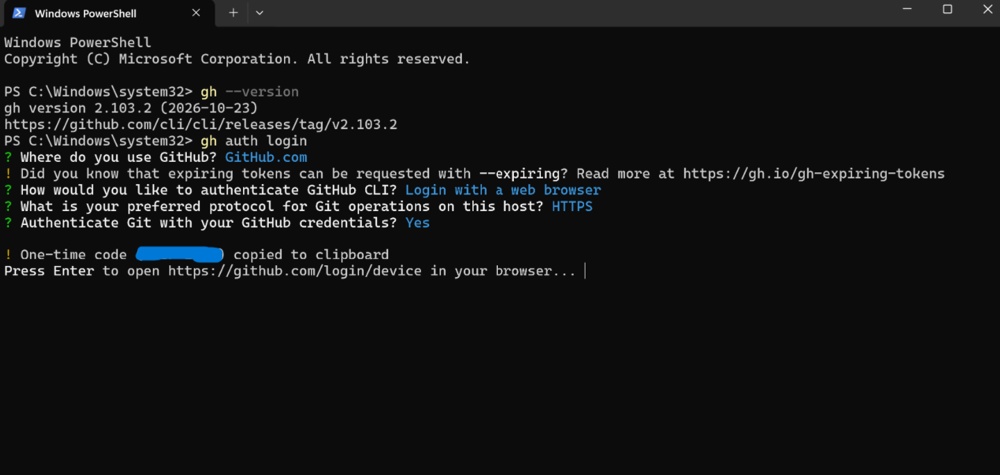
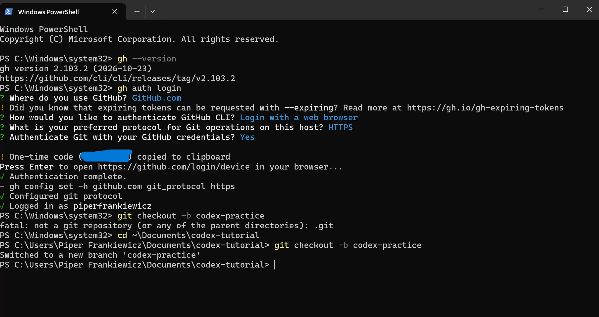

# Codex Tutorial

Codex is an AI coding assistant from OpenAI. In the terminal, you describe what you want in plain English, and Codex proposes the commands or file edits, then asks for your permission before running them. This chapter shows how to install and configure Codex, then use it for **version control** and **pull request** workflows.

> **Note:** Codex works with a free ChatGPT account, but free usage is limited. Messages are counted in a five-hour window, and weekly limits may also apply. If you see a usage-limit message, wait for the window to reset and continue later.

## Installation & Setup

OpenAI offers Codex in two formats:

* **Codex Desktop App (GUI):** A visual app downloaded directly from the website.

* **Codex CLI (Command-Line Tool):** A terminal-based tool for running git, terminal commands, and automated edits.

> **Which one is this guide for?** This tutorial focuses on the **Codex CLI** because version control and pull request workflows take place in the terminal. However, you can also download the standalone desktop app directly from [openai.com/codex](https://openai.com/codex) if you prefer a graphical interface.

Official Repository: [OpenAI Codex on GitHub](https://github.com/openai/codex)

### Step 1: Check Prerequisites

Before installing the Codex CLI, verify that **Git**, **Node.js**, and **npm** are installed on your computer. Follow the instructions for your specific operating system:

#### Mac Setup

1. Open the **Terminal** application (press `Cmd + Space`, type `Terminal`, and press **Enter**).

2. Type the following commands:

```
git --version
node --version
npm --version

```

If Terminal outputs `command not found`:

* **Git:** Install Xcode Command Line Tools by running `xcode-select --install` in Terminal, or download Git from .

* **Node.js & npm:** Download the LTS installer from or install via Homebrew using `brew install node`.

#### Windows Setup

1. Press the **Windows Key**, type **PowerShell**, and open it.

2. Type the following commands:

```
git --version
node --version
npm --version

```


*(Note: Screenshots in this guide feature Windows PowerShell).*

If PowerShell outputs `"command not found"` or an unrecognized command error:

* Install Git from .

* Install the LTS version of Node.js from .

* Close PowerShell, open a new PowerShell window, and recheck the commands.


### Step 2: Install Codex CLI

Choose the installation method for your operating system.

#### Mac Installation

On a Mac, you can install Codex using **Homebrew** (macOS package manager), **npm**, or directly via the terminal installer script from OpenAI:

* **Option A — Homebrew (Recommended for Mac):**

  ```
  brew install --cask codex
  
  ```

* **Option B — Direct Shell Installer (Skips Node.js/Homebrew):**

  ```
  curl -fsSL https://chatgpt.com/codex/install.sh | sh
  
  ```

* **Option C — Node Package Manager (npm):**

  ```
  npm install -g @openai/codex
  
  ```

#### Windows Installation

On Windows, you can install Codex using **PowerShell**, **npm**, or **winget**:

* **Option A — Direct PowerShell Installer (Recommended for Windows):**

  ```
  powershell -ExecutionPolicy ByPass -c "irm https://chatgpt.com/codex/install.ps1 | iex"
  
  ```

* **Option B — Node Package Manager (npm):**

  ```
  npm install -g @openai/codex
  
  ```

* **Option C — Windows Package Manager (winget):**

  ```
  winget install -e --id OpenAI.Codex
  
  ```

### Step 3: Verify Installation

Verify the CLI installation by running the following command in your terminal (Terminal on macOS, PowerShell on Windows):

```
codex --version

```

If a version number prints, Codex is ready to use!

**Troubleshooting:**

* `codex: command not found`: Close all active terminal windows, open a new terminal, and run `codex --version` again.

## Configuration

Two separate logins are needed:

| Login | What it is for | How to set it up | 
| ----- | ----- | ----- | 
| ChatGPT login | Lets Codex (the AI) work for you | Sign in when Codex first starts | 
| GitHub login | Lets your computer push to GitHub and open pull requests | `gh auth login` | 

The Codex command-line tool does not have its own "connect GitHub" button. When you ask Codex to commit, push, or open a pull request, it runs the same git and GitHub commands you could run yourself, using the GitHub login on your computer. So linking Codex to GitHub means setting up git and the GitHub CLI as shown below.

### Fork and clone the repository

Follow the instructions linked [here](https://prof-rossetti.github.io/version-control-tutorial/exercises/1-version-control-workflow/)


### Sign in to Codex with a ChatGPT account

1. In the terminal, make sure you are inside the repo folder.

2. Type `codex` and press Enter.

3. Choose **Sign in with ChatGPT**.

4. A browser window opens. Log in with your ChatGPT account (a free account works) and approve access.
    

5. Return to the terminal. When a message box appears, Codex is ready.

6. To leave Codex, press Ctrl + C (twice if needed).

### Tell git who you are

Every commit is stamped with a name and email. Check whether they are set to your personal information:

```
git config --global user.name
git config --global user.email

```

If either prints nothing, set them (use the email tied to your GitHub account):

```
git config --global user.name "Your Name"
git config --global user.email "you@example.com"

```

### Log your computer in to GitHub

This step links your computer, and therefore Codex, to your GitHub account. It uses the GitHub CLI (`gh`).

1. Install the GitHub CLI:

   * **Mac with Homebrew:** `brew install gh`

   * **Windows:** `winget install --id GitHub.cli`

   * **Other:** download directly from

2. Close and reopen the terminal, then run `gh --version` to confirm.

3. Run:

```
gh auth login

```

4. Answer the prompts:

   * *Where do you use GitHub?* **GitHub.com**

   * *What is your preferred protocol for Git operations?* **HTTPS**

   * *Authenticate Git with your GitHub credentials?* **Yes**

   * *How would you like to authenticate GitHub CLI?* **Login with a web browser**

5. Copy the one-time code shown in the terminal, press Enter, and paste the code into the GitHub page that opens in your browser. Click **Continue**, then **Authorize**.
    

6. Verify the login:

```
gh auth status

```


### Where Codex keeps its settings

Codex stores its settings in `~/.codex/config.toml`. No changes are needed for this walkthrough. Never copy anything from the `~/.codex` folder into a repository, because it can contain login information.

## Usage

The workflows below use a throwaway practice branch so nothing affects the real project. Simple steps are typed directly with git, and Codex is used for the steps that show what it can do.

### Version Control Workflow

1. **Create a branch (typed directly).**

```
git checkout -b codex-practice

```

Git replies "Switched to a new branch."



2. **Start Codex.**

```
codex

```

3. **Ask Codex to create a file.** Type this prompt:

   > Create a file called codex-test.md containing a short paragraph explaining what a git branch is.

   Codex shows what it wants to do and asks for permission. Nothing is changed until you approve, which is an important safety feature. Review the request, then approve it.

4. **Look at what changed.** Type this prompt:

   > Run git status and show me the diff.

   `git status` lists the files that changed. A diff shows exactly which lines were added or removed.

5. **Ask Codex to commit.** Type this prompt:

   > Stage codex-test.md and commit it with the message "Add codex test file".

   Staging marks a file to be included in the next snapshot, and committing takes the snapshot. Approve the commands when Codex asks.

6. **Check the history (typed directly).** Press Ctrl + C to leave Codex, then run:

```
git log --oneline

```

The new commit message appears at the top. Press `q` if the list stays open.

7. **Push the branch to GitHub (typed directly).**

```
git push -u origin codex-practice

```

8. **Confirm on GitHub.** Open your fork, use the branch dropdown to switch to `codex-practice`, and check that `codex-test.md` is listed.


### Pull Request Workflow

This practice pull request is opened inside your own fork, so it does not add clutter to the original repository.

1. **Ask Codex to open the pull request.** Start Codex again with `codex` and type this prompt:

   > Use the GitHub CLI to open a pull request from the current branch into main on my fork. Write a clear title and a short description.

   Approve the commands. Codex runs `gh pr create`. If it asks which repository to use, choose your own fork, not the original.
   If Codex has trouble, leave Codex and run the command yourself:

```
gh pr create --repo <your-username>/<repo-name> --base main --head codex-practice --title "Add Codex test file" --body "Practice pull request."

```


2. **View the pull request on GitHub.** Open the link that was printed, or go to the **Pull requests** tab on your fork. Check the title, description, and the **Files changed** tab.


3. **Clean up.**

```
git checkout main
git branch -D codex-practice
git push origin --delete codex-practice

```

If the default branch is named `master`, use that name instead of `main`.

## Tips and troubleshooting

* **Plan your prompts.** On a free account, write prompts in advance and keep them short and specific to save usage.

* **Review before approving.** Codex asks before it runs commands or edits files. Read each request before approving.

* **Authentication errors on push.** Run `gh auth login` again, then `gh auth status`.

* **`fatal: not a git repository`.** You are not inside the repo folder. Use `cd <repo-name>` first.

* **Pull request aimed at the wrong repository.** On the pull request page, change the base repository, or close it and create a new one.
